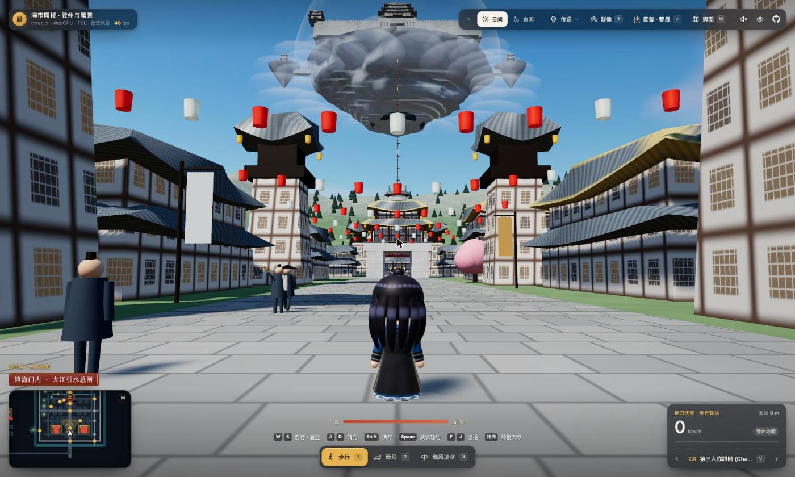
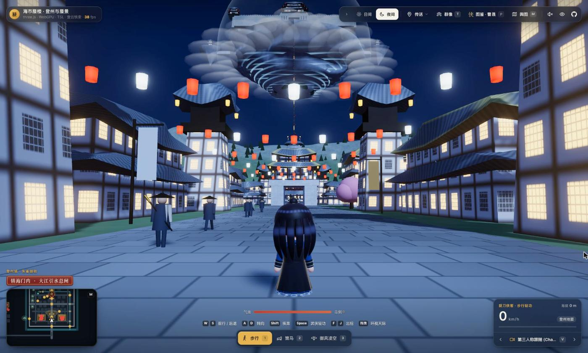
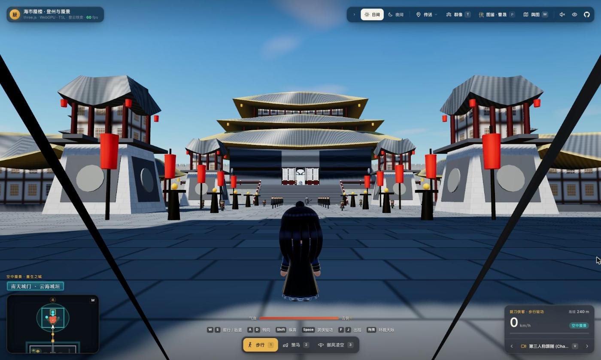

<div align="center">

# Open Sky Mirage World

**海市蜃楼 · 登州与空中蜃景** — a real-time 3D fan-made world inspired by the Chinese TV series *Sky Mirage* (海市蜃楼), running entirely in the browser

[](https://threejs.org/)
[](https://www.w3.org/TR/webgpu/)
[](https://vite.dev/)
[](LICENSE)
[](https://github.com/WhiteTowerAI/ohmygame)

**English** · [简体中文](README.md)

[Getting Started](#getting-started) · [External Agents](#external-agents) · [Project Structure](#project-structure) · [Disclaimer](#disclaimer)



</div>

<br>

The ancient city of **Dengzhou** on the ground (crossroad wards, drum tower, peach-blossom market, the swordsmen's tavern, the northern cliff) and the **Sky Mirage / alien mothership** floating above a sea of clouds (an inverted-cone island, multi-eaved palaces, the central stone hall, a cloud vortex beneath) share a single world coordinate space. They are linked by a ~200 m **iron chain**, and you can travel between them on foot, on horseback, or by climbing the chain, and a remote-controlled UFO ("Visitor from Beyond") gives an overview from the sky.

<table>
  <tr>
    <td width="50%"></td>
    <td width="50%"></td>
  </tr>
  <tr>
    <td align="center"><sub>Dengzhou · Night mode</sub></td>
    <td align="center"><sub>Sky Mirage · Southern Gate</sub></td>
  </tr>
</table>

---

<a id="getting-started"></a>

## 🚀 Getting Started

> [!NOTE]
> Requires Node.js and a modern browser with WebGPU support (Chrome 113+ / Edge 113+ / Safari 18+).

```bash
npm install
npm run dev      # start the dev server, then open the URL shown in the terminal
npm run build    # build to dist/, deployable to any static host
```

> [!TIP]
> For a quick preview, you can also open `index.html` with any static server (e.g. VS Code's Live Server). Three.js is then loaded from a CDN, so an internet connection is required, and external agents are unavailable.

### Tests

```bash
npm run test:characters   # character models, poses, identity switching and movement
npm run test:party        # party mode: following, combat, body swap, directives
npm run test:bridge       # the local bridge and MCP tools for external agents
```

---

<a id="external-agents"></a>

## 🤖 External Agents

Local development only: in party mode (`T`), companions can be directed by Claude Code or Codex, one agent per character. The corresponding CLI must be installed and signed in on your machine.

```bash
npm run agents -- zengqian=claude linhan=codex   # start this first, then npm run dev
```

- **Options**: `<character>=claude|codex` (characters: `caosheng` `zengqian` `fengbuhai` `yunniang` `xiejingtang` `linhan`), `--minutes` (auto-stop, default 10), `--claude-model`, `--codex-model`, `--effort`.
- **What agents can do**: they have only two tools, `observe` (wait for events and read the situation) and `act` (change directive or say a line). Movement and attacks are still handled every frame by the in-game rule-based AI.
- **Permissions**: each agent starts in an empty temporary directory, and Codex runs in a read-only sandbox. The local bridge listens only on `127.0.0.1:8787` and rejects cross-origin requests. You can also start it alone with `npm run bridge` and connect any MCP client to `http://127.0.0.1:8787/mcp?actor=<character>`.

---

<a id="project-structure"></a>

## 📂 Project Structure

```text
open-sky-mirage-world/
├── index.html          # entry point
├── vite.config.js      # build config
├── css/                # HUD, map, character gallery and combat UI styles
├── js/
│   ├── main.js         # render loop and initialization
│   ├── world-config.js # world coordinates, sky presets and locations
│   ├── dengzhou-city.js / sky-mirage.js / iron-chain.js   # Dengzhou, the sky mirage, the iron chain
│   ├── baili-*.js / homeworld*.js / golden-city.js       # Baili mansion, alien homeworld, ancient alien city
│   ├── lead-*.js       # character models, poses, attacks and gallery
│   ├── enemies.js      # enemies and bosses
│   ├── party*.js / actor-brain.js / agent-link.js        # party mode, companion AI, external agent link
│   └── ...             # controllers, cameras, lighting, materials, audio, etc.
├── assets/characters/runtime-previews/   # gallery screenshots
├── docs/screenshots/   # README screenshots
├── canvas/             # OhMyGame editor canvas data
└── scripts/            # local bridge, agent launcher and tests
```

---

## 🔗 References

- [Kimi + Blender 3D character & scene workflow (Chinese)](https://www.zhihu.com/tardis/zm/art/2099461534741160787?source_id=1003)
- [mrdoob/slop-newyork](https://github.com/mrdoob/slop-newyork) (MIT): ideas for the street grid, facade windows and instanced chunk culling in the ancient alien city

---

<a id="disclaimer"></a>

## ⚖️ Disclaimer

> [!IMPORTANT]
> This is an unofficial, non-commercial fan project with no affiliation to the producers, rights holders, cast or crew of the TV series *Sky Mirage* (海市蜃楼). All rights to the title, character names and world setting belong to their respective owners. Every scene and character in this repository is a procedurally generated cartoon interpretation built in code; no footage, posters or actor likenesses are included. If you believe anything here infringes your rights, please open an issue and it will be addressed promptly.

---

## 📄 License

The source code is released under the [MIT License](LICENSE). The license applies only to the source code in this repository and grants no rights to any work, character, name or trademark associated with the TV series *Sky Mirage* (海市蜃楼).

---

## 🙏 Acknowledgements

This project was built primarily with [OhMyGame](https://github.com/WhiteTowerAI/ohmygame).
