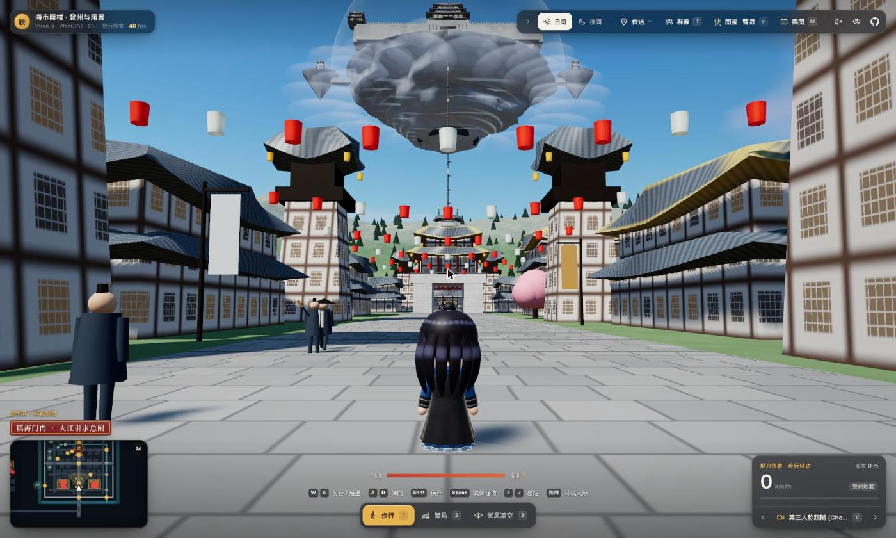
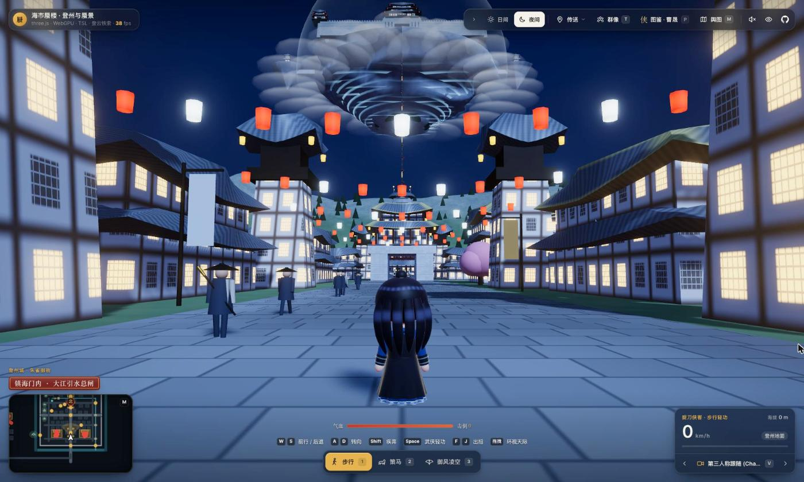
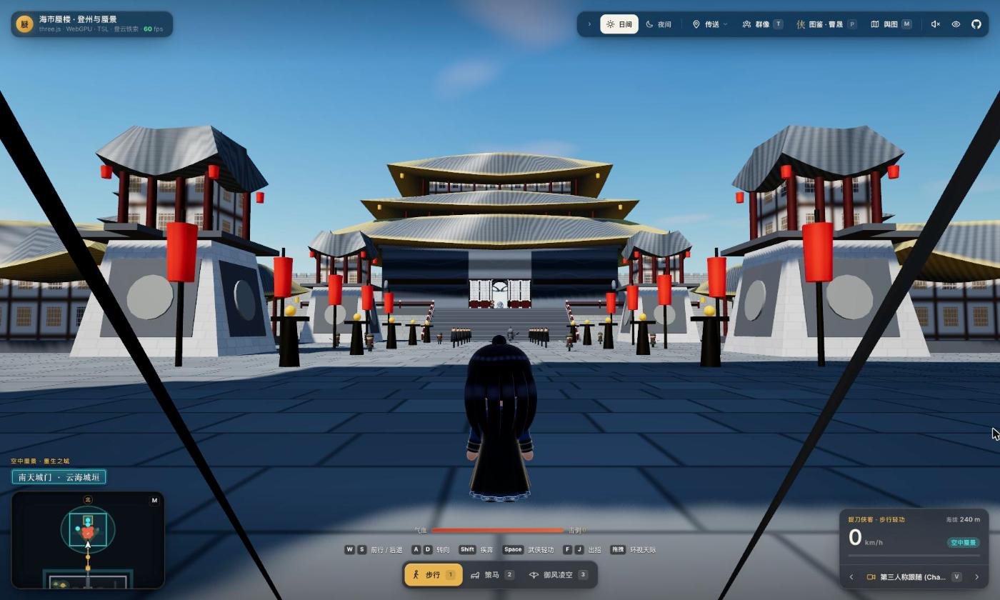

<div align="center">

# 海市蜃楼 · 登州与空中蜃景

**Open Sky Mirage World** — 一个在浏览器里实时运行的《海市蜃楼》同人 3D 漫游世界

[](https://threejs.org/)
[](https://www.w3.org/TR/webgpu/)
[](https://vite.dev/)
[](LICENSE)
[](https://github.com/WhiteTowerAI/ohmygame)

[English](README.en.md) · **简体中文**

[快速开始](#-本地运行) · [外部 Agent](#-外部-agent) · [目录结构](#-目录结构) · [声明](#disclaimer)



</div>

<br>

地面的 **登州古城**（十字街坊、鼓楼、桃花闹市、捉刀人酒肆、北山登云崖）与悬在云海之上的 **空中蜃景 / 天外母舰**（倒锥浮岛、重檐宫阙、中枢石殿、底部旋涡云洞）处在同一个世界坐标系里，由一条长约 200 米的 **登云玄铁索** 相连，可以步行、策马或攀索往返，也能召来“天外来客”飞碟高空总览。

<table>
  <tr>
    <td width="50%"></td>
    <td width="50%"></td>
  </tr>
  <tr>
    <td align="center"><sub>登州城 · 夜间模式</sub></td>
    <td align="center"><sub>空中蜃景 · 南天城门</sub></td>
  </tr>
</table>

---

## 🚀 本地运行

> [!NOTE]
> 需要 Node.js 和支持 WebGPU 的现代浏览器（Chrome 113+ / Edge 113+ / Safari 18+）。

```bash
npm install
npm run dev      # 启动开发服务器，打开终端里显示的地址
npm run build    # 构建到 dist/，可部署到任意静态托管
```

> [!TIP]
> 只想快速预览的话，也可以用任意静态服务器（如 VS Code 的 Live Server）直接打开 `index.html`，此时 Three.js 从 CDN 加载，需要联网，外部 Agent 不可用。

### 测试

```bash
npm run test:characters   # 角色模型、动作、切换身份和移动
npm run test:party        # 群像：跟随、交战、换人、动机
npm run test:bridge       # 外部 Agent 的本地桥和 MCP 工具
```

---

## 🤖 外部 Agent

仅本地开发可用：群像模式（`T`）里的角色可以交给 Claude Code 或 Codex 指挥，每个角色一个 Agent，需要本机已安装并登录对应的命令行工具。

```bash
npm run agents -- zengqian=claude linhan=codex   # 先启动这个，再 npm run dev
```

- **参数**：`角色=claude|codex`（角色可选 `caosheng` `zengqian` `fengbuhai` `yunniang` `xiejingtang` `linhan`）、`--minutes`（默认 10 分钟后自动停止）、`--claude-model`、`--codex-model`、`--effort`。
- **能做的**：Agent 只有 `observe`（查看局势）和 `act`（改动机、说台词）两个工具；走位和出招仍由游戏内规则 AI 完成。
- **权限**：每个 Agent 从临时空目录启动，Codex 在只读沙箱中运行；本地桥只监听 `127.0.0.1:8787` 并拒绝跨站请求。也可用 `npm run bridge` 单独启动，让任意 MCP 客户端连接 `http://127.0.0.1:8787/mcp?actor=<角色>`。

---

## 📂 目录结构

```text
open-sky-mirage-world/
├── index.html          # 主入口
├── vite.config.js      # 构建配置
├── css/                # HUD、舆图、图鉴与战斗界面样式
├── js/
│   ├── main.js         # 渲染循环与初始化
│   ├── world-config.js # 世界坐标、天象与地点数据
│   ├── dengzhou-city.js / sky-mirage.js / iron-chain.js   # 登州城、空中蜃景、登云铁索
│   ├── baili-*.js / homeworld*.js / golden-city.js       # 百里府、天外母星、天外旧都
│   ├── lead-*.js       # 人物模型、动作、招式与图鉴
│   ├── enemies.js      # 敌人与 Boss
│   ├── party*.js / actor-brain.js / agent-link.js        # 群像、同伴 AI 与外部 Agent 连接
│   └── ...             # 控制器、机位、灯光、材质、音效等
├── assets/characters/runtime-previews/   # 图鉴截图
├── docs/screenshots/   # README 截图
├── canvas/             # OhMyGame 编辑器画布数据
└── scripts/            # 本地桥、Agent 启动与自动测试
```

---

## 🔗 参考资料

- [Kimi + Blender 3D 角色与场景工作流参考](https://www.zhihu.com/tardis/zm/art/2099461534741160787?source_id=1003)
- [mrdoob/slop-newyork](https://github.com/mrdoob/slop-newyork)（MIT）：天外旧都的街区网格、立面窗格与实例切块剔除思路

---

<a id="disclaimer"></a>

## ⚖️ 声明

> [!IMPORTANT]
> 本项目为非官方、非商业的同人作品，与电视剧《海市蜃楼》的出品方、版权方及演职人员无任何关联。剧名、角色名与世界观设定的相关权利归原权利人所有。仓库内所有场景与人物均为代码程序化生成的卡通演绎，不包含任何原片画面、海报或演员肖像。如有侵权请提 Issue 联系，将第一时间处理。

---

## 📄 协议

源代码以 [MIT](LICENSE) 协议开源。该协议仅适用于本仓库的源代码，不授予任何与电视剧《海市蜃楼》相关的作品、角色、名称或商标的权利。

---

## 🙏 致谢

本项目主要借助 [OhMyGame](https://github.com/WhiteTowerAI/ohmygame) 构建。
